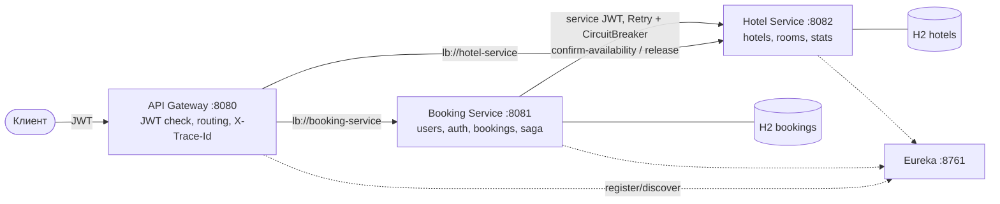
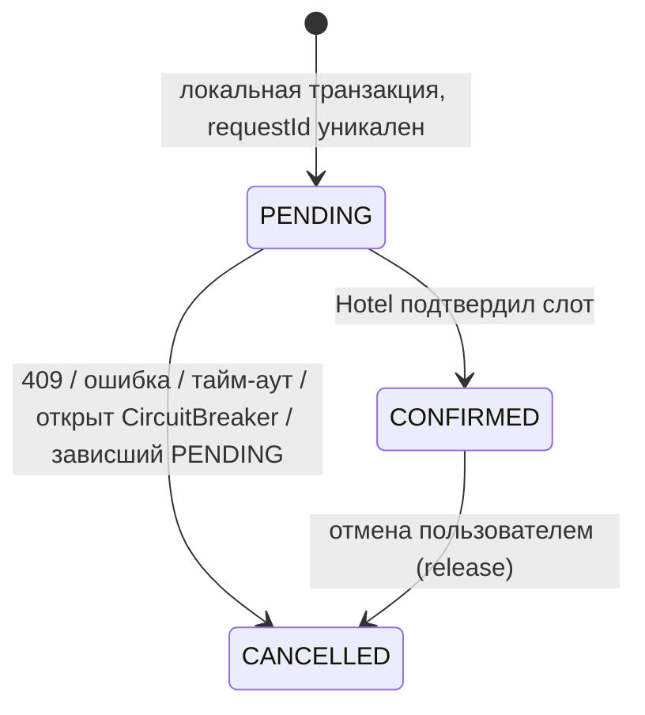

# SF Spring Hotels

REST API системы бронирования отелей на Spring Boot 3.5 / Spring Cloud 2025.0 в микросервисной архитектуре:
API Gateway, Eureka, Hotel Management Service и Booking Service. Бронирование согласуется между сервисами
сагой из двух шагов (PENDING → CONFIRMED / CANCELLED) с компенсацией, повторами, тайм-аутами и Circuit Breaker.

## Содержание

- [Архитектура](#архитектура)
- [Модули](#модули)
- [Быстрый старт](#быстрый-старт)
- [Демо-данные](#демо-данные)
- [Эндпойнты](#эндпойнты)
- [Сценарий проверки через curl](#сценарий-проверки-через-curl)
- [Сага бронирования](#сага-бронирования)
- [Планирование загрузки номеров](#планирование-загрузки-номеров)
- [Безопасность](#безопасность)
- [Ошибки, логирование, трассировка](#ошибки-логирование-трассировка)
- [Тестирование](#тестирование)
- [Документация разработчика](#документация-разработчика)

## Архитектура



- Каждый сервис — отдельное Spring Boot приложение со своей in-memory H2.
- Gateway и оба бизнес-сервиса работают как OAuth2 Resource Server и **каждый** проверяет подпись и срок JWT (HS256).
- Роли проверяются на сервисах через `@PreAuthorize` (USER, ADMIN, INTERNAL для межсервисных вызовов).
- Внутренние эндпойнты `confirm-availability` и `release` через Gateway не публикуются (404).

## Модули

| Модуль | Порт | Назначение |
|---|---|---|
| `common` | — | Библиотека: JWT Resource Server, единый `ApiError` и `GlobalExceptionHandler`, роли, `PageResponse`, валидация дат, OpenAPI, общие настройки (`sfhotels-common.yml`) |
| `eureka-server` | 8761 | Service Registry |
| `api-gateway` | 8080 | Spring Cloud Gateway: маршрутизация через Eureka (`lb://`), проверка JWT, сокрытие внутренних маршрутов, логирование запросов с traceId |
| `hotel-service` | 8082 | CRUD отелей и номеров, фильтры и сортировки, рекомендации по `times_booked`, временная блокировка слотов, статистика загрузки |
| `booking-service` | 8081 | Регистрация/вход (JWT), администрирование пользователей, бронирования, сага с компенсацией, автоподбор номера |

Структура пакетов сервисов: `controller` → `service` → `repository` → `entity`, плюс `dto`, `mapper` (MapStruct),
`client` (HTTP-клиент к Hotel Service), `config`, `security`.

## Быстрый старт

### Docker Compose (рекомендуется)

Требуется Docker с Compose v2. Сборка Maven выполняется внутри контейнера, локальная JDK не нужна.

```bash
docker compose up --build
```

После старта (около 1–2 минут) доступны:

- Gateway: http://localhost:8080
- Eureka dashboard: http://localhost:8761
- Swagger Booking Service: http://localhost:8081/swagger-ui.html
- Swagger Hotel Service: http://localhost:8082/swagger-ui.html

Секрет подписи JWT задаётся переменной `JWT_SECRET` (минимум 32 байта), по умолчанию используется dev-значение.

### Локально через Maven

Нужны JDK 17+ и Maven 3.9+. Запуск в отдельных терминалах в таком порядке:

```bash
mvn -DskipTests install
```

```bash
mvn -pl eureka-server spring-boot:run
```

```bash
mvn -pl hotel-service spring-boot:run
```

```bash
mvn -pl booking-service spring-boot:run
```

```bash
mvn -pl api-gateway spring-boot:run
```

Внешних зависимостей кроме Maven Central нет: Lombok и MapStruct подключаются как annotation processors в корневом `pom.xml`.

Если на машине несколько сетевых адаптеров (VirtualBox, VPN) и Gateway не достучится до сервисов,
регистрируйте их в Eureka по loopback-адресу:

```bash
mvn -pl booking-service spring-boot:run -Dspring-boot.run.arguments=--eureka.instance.ip-address=127.0.0.1
```

## Демо-данные

Загружаются при старте (`app.demo-data.enabled=true`) и согласованы между сервисами.

| Пользователь | Пароль | Роль |
|---|---|---|
| admin | admin123 | ADMIN |
| user | user123 | USER |
| alice | alice123 | USER |
| bob | bob12345 | USER (без бронирований — можно удалять) |

| Отель | Номера (id: номер, times_booked) |
|---|---|
| 1 Grand Neva, Saint Petersburg | 1: 101 (3), 2: 102 (0), 3: 103 (1), 4: 201 (5, **на ремонте**, `available=false`) |
| 2 Moscow Central, Moscow | 5: 11 (2), 6: 12 (2), 7: 13 (0) |
| 3 Kazan Riverside, Kazan | 8: 1 (0), 9: 2 (4) |

Бронирования: `user` — номер 1 на дни +5..+8 и номер 5 на +10..+12 (CONFIRMED), `alice` — номер 6 (CANCELLED).
Слоты подтверждённых бронирований заблокированы в Hotel Service, поэтому повторное бронирование номера 1
на пересекающиеся даты вернёт 409, а автоподбор выберет номер с минимальным `times_booked`.

## Эндпойнты

Все пути даны относительно Gateway `http://localhost:8080`. Даты — ISO `yyyy-MM-dd`.

### Booking Service

| Метод | Путь | Роль | Описание |
|---|---|---|---|
| POST | `/api/user/register` | публичный | Регистрация USER, возвращает JWT на 1 час |
| POST | `/api/user/auth` | публичный | Вход, возвращает JWT на 1 час |
| GET | `/api/user?page&size&sort` | ADMIN | Список пользователей |
| GET | `/api/user/{id}` | ADMIN | Пользователь |
| POST | `/api/user` | ADMIN | Создать пользователя с ролью |
| PATCH | `/api/user/{id}` | ADMIN | Частично обновить (username, password, role) |
| DELETE | `/api/user/{id}` | ADMIN | Удалить (409, если есть бронирования) |
| POST | `/api/booking` | USER/ADMIN | Создать бронирование: `roomId` или `autoSelect: true` (+ опционально `hotelId`), `requestId` — ключ идемпотентности |
| GET | `/api/booking/{id}` | владелец/ADMIN | Бронирование по id (чужое — 403) |
| DELETE | `/api/booking/{id}` | владелец/ADMIN | Отмена, снимает блокировку слота в Hotel Service |
| GET | `/api/bookings?page&size&sort` | USER/ADMIN | Своя история, по умолчанию новые сверху |
| GET | `/api/bookings/recommendations?startDate&endDate&hotelId` | USER/ADMIN | Рекомендованные номера: `times_booked` ↑, затем `id` ↑ |

Тело `POST /api/booking`:

```json
{ "roomId": 2, "autoSelect": false, "startDate": "2026-12-01", "endDate": "2026-12-04", "requestId": "my-key-001" }
```

Валидация: обе даты обязательны, `startDate` не в прошлом, `startDate < endDate`, не более 30 ночей,
`roomId` обязателен при `autoSelect=false`.

### Hotel Service

| Метод | Путь | Роль | Описание |
|---|---|---|---|
| GET | `/api/hotels?name&city&page&size&sort` | USER/ADMIN | Отели с фильтрами, пагинацией и сортировкой |
| GET | `/api/hotels/{id}` | USER/ADMIN | Отель |
| POST / PUT / DELETE | `/api/hotels`, `/api/hotels/{id}` | ADMIN | CRUD отелей |
| GET | `/api/hotels/stats?from&to` | ADMIN | Загрузка по отелям: номера, сумма `times_booked`, занятые ночи, % загрузки |
| GET | `/api/rooms?hotelId&minCapacity&startDate&endDate` | USER/ADMIN | Свободные номера (рабочие и не занятые на даты), сортировка по id |
| GET | `/api/rooms/recommend?…` | USER/ADMIN/INTERNAL | Те же свободные номера, `times_booked` ↑, `id` ↑ |
| GET | `/api/rooms/{id}` | USER/ADMIN | Номер |
| POST / PUT / DELETE | `/api/rooms`, `/api/rooms/{id}` | ADMIN | CRUD номеров |
| GET | `/api/rooms/stats?from&to&hotelId` | ADMIN | Загрузка по номерам за период (по умолчанию 30 дней от сегодня) |
| POST | `/api/rooms/{id}/confirm-availability` | INTERNAL | Подтвердить и заблокировать слот (идемпотентно по `requestId`) |
| POST | `/api/rooms/{id}/release` | INTERNAL | Компенсация: снять блокировку (идемпотентно) |

Последние два маршрута доступны только Booking Service напрямую и через Gateway возвращают 404.

## Сценарий проверки через curl

```bash
TOKEN=$(curl -s -X POST localhost:8080/api/user/auth -H 'Content-Type: application/json' -d '{"username":"user","password":"user123"}' | sed -E 's/.*"accessToken":"([^"]+)".*/\1/')
```

```bash
curl -s "localhost:8080/api/bookings/recommendations?startDate=2026-12-01&endDate=2026-12-04" -H "Authorization: Bearer $TOKEN"
```

```bash
curl -s -X POST localhost:8080/api/booking -H "Authorization: Bearer $TOKEN" -H 'Content-Type: application/json' -d '{"autoSelect":true,"startDate":"2026-12-01","endDate":"2026-12-04","requestId":"demo-1"}'
```

Повторите последнюю команду: вернётся то же бронирование (идемпотентность по `requestId`), новый слот не блокируется.

```bash
curl -s localhost:8080/api/bookings -H "Authorization: Bearer $TOKEN"
```

```bash
ADMIN=$(curl -s -X POST localhost:8080/api/user/auth -H 'Content-Type: application/json' -d '{"username":"admin","password":"admin123"}' | sed -E 's/.*"accessToken":"([^"]+)".*/\1/')
```

```bash
curl -s localhost:8080/api/rooms/stats -H "Authorization: Bearer $ADMIN"
```

Проверка компенсации: остановите Hotel Service (`docker compose stop hotel-service`) и создайте бронирование —
ответ 503, бронирование в истории в статусе CANCELLED, в логах `booking-service` видны повторы, переход
в CANCELLED и результат компенсации.

## Сага бронирования



1. Booking Service проверяет `requestId`: если бронирование уже есть — возвращает его (повторная доставка).
2. Локальная транзакция создаёт бронирование `PENDING` (уникальный индекс по `request_id` защищает от гонки дублей).
3. Вызов `POST /api/rooms/{id}/confirm-availability` с `requestId` и `bookingId`. Hotel Service берёт
   пессимистичную блокировку строки номера, проверяет пересечения дат и создаёт блокировку слота, увеличивая `times_booked`.
4. Успех → `CONFIRMED`. 409 → при автоподборе пробуется следующий кандидат, иначе `CANCELLED` и 409.
5. 5xx / тайм-аут → до 3 попыток с экспоненциальной паузой (Resilience4j Retry), затем компенсация:
   `release` (тоже с повторами) и `CANCELLED`, ответ 503. При открытом CircuitBreaker вызов не выполняется вовсе.
6. Фоновая задача `PendingBookingReaper` компенсирует бронирования, зависшие в `PENDING` дольше 2 минут.

`release`, пришедший раньше запоздалого `confirm`, оставляет маркер `RELEASED` с тем же `requestId`,
поэтому запоздалый `confirm` будет отклонён и слот не «утечёт».

## Планирование загрузки номеров

- Hotel Service хранит счётчик `times_booked` (растёт при подтверждении, уменьшается при снятии блокировки).
- `GET /api/rooms/recommend` возвращает только свободные на даты и рабочие номера, отсортированные
  по `times_booked` по возрастанию, при равенстве — по `id`.
- Автоподбор (`autoSelect: true`) берёт до 3 первых кандидатов и последовательно пытается их подтвердить,
  поэтому при конкурентных запросах занятый номер пропускается, а нагрузка распределяется равномерно.
- Конкурентные попытки занять один номер на пересекающиеся даты сериализуются блокировкой `SELECT … FOR UPDATE`:
  успешна ровно одна, остальные получают 409.

## Безопасность

- JWT HS256, срок жизни 1 час, claims: `sub` (username), `uid`, `roles`.
- Gateway проверяет токен на входе, затем передаёт заголовок `Authorization` в сервисы, где токен проверяется повторно.
- Booking Service ходит в Hotel Service с собственным короткоживущим токеном роли `INTERNAL`.
- Ответы: 401 — нет/просрочен/подделан токен, 403 — нет роли или чужой ресурс. Тело в формате `ApiError`.
- Пароли хранятся в BCrypt.

## Ошибки, логирование, трассировка

Все ошибки возвращаются в едином формате:

```json
{
  "timestamp": "2026-11-07T11:00:00Z",
  "status": 409,
  "error": "Conflict",
  "message": "Room 1 is already booked for the requested dates",
  "path": "/api/booking",
  "traceId": "6aef0f7a3d5a51cd7bc67156389b4f38",
  "details": { "startDate": "must be a date in the present or in the future" }
}
```

- Micrometer Tracing (Brave, W3C `traceparent`) связывает Gateway → Booking → Hotel одним `traceId`;
  Gateway возвращает его в заголовке `X-Trace-Id`.
- Консольный лог содержит `[traceId-spanId]`; ключевые шаги саги логируются с `bookingId` и `requestId`
  (также `bookingId` кладётся в MDC).
- Структурный JSON-лог (ECS) пишется в `logs/<service>.json` внутри контейнера/рабочего каталога.
- Повторы Retry и смена состояний CircuitBreaker логируются отдельными событиями.

## Тестирование

```bash
mvn test
```

Тесты не зависят от окружения: H2 in-memory, Eureka отключена, Hotel Service в тестах Booking Service и
бэкенды Gateway заменены WireMock. Основные сценарии:

- `BookingSagaTest` — успех, ошибка удалённого сервиса (3 попытки + компенсация), тайм-аут, восстановление
  после сбоя на повторе, 409 без повторов и компенсации, повторная доставка запроса, автоподбор с пропуском
  занятого номера, открытый CircuitBreaker.
- `BookingConcurrencyTest` — параллельная доставка одного `requestId` создаёт одно бронирование и один вызов Hotel.
- `PendingBookingReaperTest` — компенсация зависшего `PENDING`.
- `BookingControllerTest` — только свои бронирования, 403 на чужие, пагинация, отмена, валидация дат.
- `AuthControllerTest`, `UserControllerTest` — регистрация, вход, 401 на отсутствующий/битый/просроченный токен, 403 по ролям.
- `RoomReservationControllerTest` — блокировка, идемпотентность, пересечения, release до confirm.
- `ReservationConcurrencyTest` — 10 параллельных бронирований одного номера: ровно одно успешно.
- `RoomControllerTest`, `HotelControllerTest` — CRUD, фильтры, сортировка рекомендаций, статистика.
- `GatewayRoutingTest` — маршрутизация, 401 без токена, проброс токена и `traceparent`, 404 для внутренних маршрутов.

Тесты написаны в стиле Arrange-Act-Assert на JUnit 5 + MockMvc / WebTestClient.

## Документация разработчика

- [Схема баз данных](docs/database.md)
- [ADR — архитектурные решения](docs/adr)
