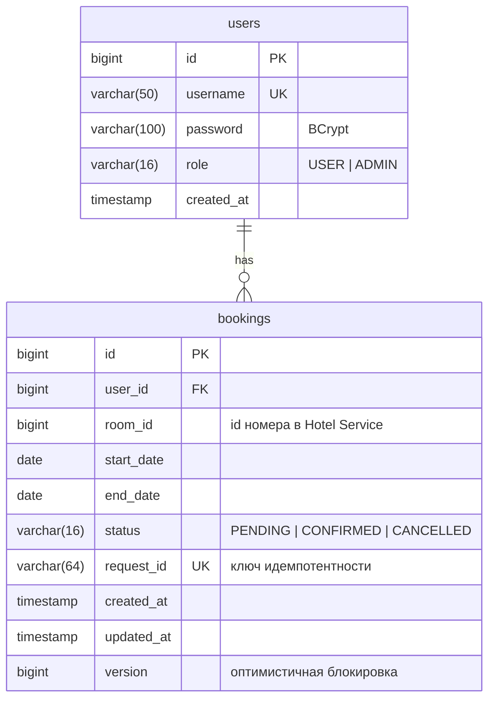
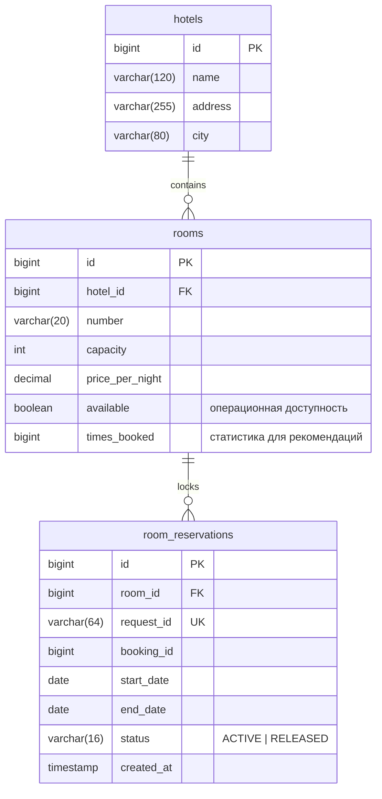

# Схема баз данных

Схемы создаются Hibernate (`ddl-auto: create-drop`) в отдельных in-memory H2 каждого сервиса.
Связи между сервисами (`bookings.room_id` → `rooms.id`) логические, без внешних ключей: у каждого сервиса своя БД.

## Booking Service (`jdbc:h2:mem:bookings`)

| Таблица | Ограничения и индексы | Зачем |
|---|---|---|
| users | `uk_users_username` | Уникальный логин |
| bookings | `uk_bookings_request_id` | Повторная доставка не создаёт дубликат |
| bookings | `idx_bookings_user_created (user_id, created_at)` | История пользователя с сортировкой |
| bookings | `idx_bookings_status_created (status, created_at)` | Поиск зависших `PENDING` |
| bookings | FK `user_id → users.id` | Нельзя удалить пользователя с бронированиями |

## Hotel Service (`jdbc:h2:mem:hotels`)

| Таблица | Ограничения и индексы | Зачем |
|---|---|---|
| hotels | `idx_hotels_city` | Фильтр по городу |
| rooms | `uk_rooms_hotel_number (hotel_id, number)` | Номер уникален внутри отеля |
| rooms | `idx_rooms_times_booked (times_booked, id)` | Сортировка рекомендаций |
| room_reservations | `uk_reservations_request_id` | Идемпотентность confirm/release |
| room_reservations | `idx_reservations_room_period (room_id, status, start_date, end_date)` | Быстрая проверка пересечения дат |

`rooms.available` отражает только операционную доступность (ремонт, вывод из эксплуатации).
Занятость по датам определяется активными записями `room_reservations` (`status = ACTIVE`),
которые являются отражением подтверждённых бронирований Booking Service.
Запись со статусом `RELEASED` без дат — маркер компенсации, пришедшей раньше подтверждения.
